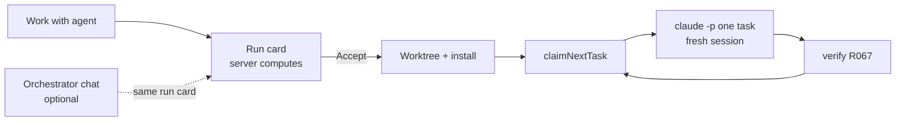

# ADR-007: Workers run task by task in a worktree, started from a run card

**Status:** ✅ Accepted
**Date:** 2026-10-20

## Context
R108 lets the user start a coding agent on an epic or a task from VibeDoc. The agent writes code in its own git worktree, and the board follows its progress. This ADR records the decisions (T552). The Spike section holds the evidence from T566, and the decisions follow it. Where the spike changed what the epic first assumed, the decision says so.

## Spike (T566)
Run on 2026-10-20 with Claude Code 2.1.304 on macOS against this repo. The hub ran at `localhost:3333`. A throwaway task `T999` ("create `spike.txt`, then try `git push` once") was created in the main checkout and removed afterwards. The worktree was `/tmp/r108-spike` on branch `spike/r108`, created from `main`. Raw NDJSON is not kept in the repo. The excerpts below are copied from it.

### Results
| Question | Answer | Evidence |
|---|---|---|
| Worktree + install cost | `git worktree add`: 0.6 s. `pnpm install --frozen-lockfile --prefer-offline`: 10.6 s (warm pnpm store) | timings |
| Does `/vibedoc:work <id>` run headless? | **Yes**, with `--plugin-dir <repo>/plugin`. `init.slash_commands` lists `vibedoc:work`. The agent followed the skill: `get_task` → `update_task in-progress` → work → Verify → commit → `update_task done` + manual tests. No `--append-system-prompt` fallback is needed. It also handled a task id, although the skill only documents epic ids | run A |
| Board follows (S2) | **Yes.** MCP `?root=<main checkout>`: `T999` became in-progress, then review, in the **main** checkout's file, and the board moved | run A, `plans/tasks/T999…` |
| Isolation (S1) | **Yes.** `spike.txt` and commit `fca4246` exist only on `spike/r108`. Main `git status` had no code change | run A |
| Task file in the worktree | The skill tried `git add plans/tasks/T999-….md` and failed: the file was only in the main checkout. In a real repo the worktree has a stale copy. The worker prompt must say: commit code only, VibeDoc owns task files | run A |
| `done` with checks left | It went to **review** (3 manual checks). The loop must treat review as finished for the worker | run A |
| User settings leak in | With default setting sources, 5 user `SessionStart` hooks ran, 24 plugins loaded, and 78 tools were available (`Task`, `Workflow`, `WebFetch`, `Cron*`, `PushNotification`, `EnterWorktree`…). The user-level CLAUDE.md also applied | run A `init` |
| Fix | `--setting-sources project,local` plus `--tools "Bash,Edit,Write,Read,Glob,Grep"`. Result: no hooks, only VibeDoc's plugin (+ built-ins), 6 built-in tools. The project `CLAUDE.md` still loads (it answered the "no `fs` outside core.ts" rule) and the user's does not (no Kotlin `!!` rule) | run B |
| Refusal: deny rule | `git push` (also inside `a && b && git push`) was refused. The stream shows a `system` event `{"subtype":"permission_denied","tool_name":"Bash","tool_use_id":…,"decision_reason_type":"subcommandResults","message":"Permission to use Bash with command git push --dry-run has been denied."}`, a `tool_result` with `is_error: true`, and `result.permission_denials: [{tool_name, tool_use_id, tool_input}]` | runs A, B |
| Refusal: not on the allowlist | `curl -sI https://example.com` → `decision_reason_type: "other"`, message `"This command requires approval"`. Simple read-only commands not on the list (`ls`, `echo hi`) ran without approval | run B |
| Minimal env | `env -i PATH HOME USER SHELL LANG TERM TMPDIR` was enough. The login came from the macOS keychain, and no token in env was needed | runs A–D |
| `--max-turns` | Counts **model round trips**, not tool calls: 26 Glob calls in one message counted as one turn (run C, `--max-turns 2`, success). With sequential calls (run C2): exit code **1**, `result.subtype: "error_max_turns"`, `terminal_reason: "max_turns"`, `errors: ["Reached maximum number of turns (2)"]` | runs C, C2 |
| Usage limits | Every turn streams a `rate_limit_event`: `{"rate_limit_info":{"status":"allowed","rateLimitType":"five_hour","resetsAt":1792478400,"unifiedWindows":{"five_hour":{"utilization":0.43,…},"seven_day":{"utilization":0.06,…}}}}`. A rejected status was **not observed** (Unknown). The utilization lets a worker pause before it hits the limit | run A |
| Session files | `~/.claude/projects/-private-tmp-r108-spike/<session>.jsonl` (slug of the cwd) | run A |
| `--resume` from another cwd | **Found the session anyway**, and then ran in the *new* cwd (the main checkout). So resume does not tie a session to its folder: VibeDoc must always pass the worktree as cwd, or a resumed worker edits the user's checkout | run D |
| Cost of one trivial task (Opus 5.5, user settings) | 38 s wall, 33 s API, `total_cost_usd` 0.73 (list price; on a subscription this is quota), 66,894 cache-creation and 708,649 cache-read input tokens, 2,437 output | run A `result` |
| Base context per fresh session (project settings only, Haiku) | 53,936 cache-creation tokens. Most of it is the project `CLAUDE.md` with its `@` includes (MEMORY.md is large) plus the 50 VibeDoc MCP tool definitions. Every task pays this once | run B `result` |
| Resume cost | Run D (resume with another model, history of run A) created 115,169 cache tokens for a one-word reply. A resume re-reads the whole session, so resume only for questions, never as the task loop | run D |

### What this changes in the tasks
- T554: argv adds `--setting-sources project,local` and `--tools "Bash,Edit,Write,Read,Glob,Grep"` (not "default sources"). The `--append-system-prompt` fallback is not needed. The worker prompt says to commit code only. Review counts as finished.
- T556 / T558: always spawn a resume with cwd = the worktree. The session file is found from any cwd, so the cwd is the only guard.
- T557: parse refusals from `system/permission_denied` (`decision_reason_type` = `subcommandResults` for a deny rule, `other` for "not allowed") and `result.permission_denials`. The minimal env above works.
- T567: detect over-budget from exit 1 + `result.subtype: "error_max_turns"`. Turns are round trips. Read `rate_limit_event.rate_limit_info` for utilization and `resetsAt`, and pause above a threshold. The rejected shape is still unknown, so also treat a non-zero exit whose text mentions a limit as a usage limit.

## Decision

### The flow

1. **The server drives a worker task by task.** It claims the next ready task with `claimNextTask` in core, runs `claude -p "/vibedoc:work <task>"` in a **fresh session** with cwd = the worktree, and repeats until the epic is finished or needs a human. A task that ends in **review** counts as finished for the worker (spike run A: a `done` with manual checks left lands in review). The skill runs headless with `--plugin-dir <repo>/plugin`, so no `--append-system-prompt` fallback is needed (spike). A fresh session costs about 54k cache tokens of base context (spike run B). A resume re-reads the whole session (115k tokens for one word, run D). So a fresh session per task is also the cheaper loop: resume is only for a worker's question (decision 9).
2. **Routing is deterministic.** "Work with agent" shows a run card that the server computes from the project's workers: the epic has a worker → send the run to it; else → a new worktree, branch and base. The card also shows the allowed tools and the budget. Nothing is created or started before the user accepts it.
3. **The orchestrator is an optional chat**, one per project. It reads every worker, answers "who is working on what" and fuzzy requests, and proposes runs only as the same run card. It never starts anything and never writes code.
4. **A worker is a chat with a worktree.** It reuses the chat store (`.vibedoc/chats/<id>.json`), the inbox (needs you) and the chat page, plus a worktree, a branch and a port.
5. **"Existing session" means a worker that VibeDoc spawned.** The user's own terminal sessions are not workers. VibeDoc does not list, attach to or send runs to them.
6. **One worker per epic.** Workers run in parallel only across epics, up to a limit of workers at the same time.
7. **Worktrees live in `<home>/worktrees/<project>/<branch-slug>`**, where `<home>` = `$VIBEDOC_HOME` or `~/.vibedoc` (the same home as `hub.json`). They are outside the repo, and dependencies are installed in each one (`pnpm install --frozen-lockfile --prefer-offline`: 10.6 s with a warm store, spike).
8. **The worker's MCP points at the main checkout.** The worker gets `--strict-mcp-config --mcp-config` with one `vibedoc` server at `<hub>/api/mcp?root=<main checkout>`. Task status and meta land in the project the board shows, so the board moves (spike S2). Code commits stay on the worker's branch (spike S1). The worker prompt says: commit code only, never `plans/tasks/*`, `plans/roadmap/*`, `memory/MEMORY.md` or `.vibedoc*`. **Spike:** the skill tried to stage the task file, which exists only in the main checkout, and a real worktree has a stale copy.
9. **The worker runs with project settings only.** The argv adds `--setting-sources project,local` and `--tools "Bash,Edit,Write,Read,Glob,Grep"`, plus the allowlist and deny rules. **Spike:** the epic first assumed the default setting sources. With them, 5 user `SessionStart` hooks ran, 24 plugins loaded, 78 tools were available, and the user's CLAUDE.md applied. With the fix, the project `CLAUDE.md` still loads and the user's does not. A question from the worker waits on the user. The answer resumes that task's session, **always with cwd = the worktree**. **Spike run D:** `--resume` finds the session from any folder and then runs in the new cwd, so the cwd is the only guard against a worker that edits the user's checkout.
10. **The allowlist is not a sandbox.** `Bash(pnpm *)` runs any package script, so a worker can run any code as the user. Spike run B also showed that simple read-only commands not on the list (`ls`, `echo`) run without approval. The mitigations are:
    - a minimal env: `env -i` with `PATH HOME USER SHELL LANG TERM TMPDIR` only, so no tokens or keys pass through. The login comes from the macOS keychain (spike runs A–D).
    - the worktree is outside the repo.
    - push is denied: `git push` is refused, also inside `a && b && git push`. The refusal shows in the stream as `system/permission_denied` and in `result.permission_denials`, which the worker's log shows (spike).
    - a budget per task: `--max-turns` (it counts model round trips, not tool calls; over budget = exit 1 + `result.subtype: "error_max_turns"`) and a time limit. A usage limit pauses the worker, using `rate_limit_event.rate_limit_info` (spike). The rejected shape of a usage limit was not observed, so a non-zero exit whose text names a limit also counts as one.

    A real sandbox is out of scope.
11. **Each task is verified (R067) before the next one starts.** Critical or major findings get one fix in the same worktree, else the worker waits on the user.
12. **Each worker gets its own dev server port**, so a UI spec tests the worktree's branch and never the user's running app.

## Rationale
A task is the natural checkpoint: it has a spec, a Verify block and one commit. A fresh session per task keeps the context small, so a crash loses one task, not the run, and the cost of the base context is paid once per task. Deterministic routing makes the same click give the same card at once, with no model in the path. The worktree, the minimal env and the deny rules keep the user's checkout and secrets out of reach, without a sandbox that VibeDoc cannot ship on every OS.

## Alternatives considered
| Option | Why rejected |
|--------|-------------|
| One `claude -p` for the whole epic | The context grows and compacts, a crash loses the whole run, and there is no checkpoint between tasks. A resume re-reads the whole session (spike run D). |
| An LLM orchestrator that decides every run | Seconds of latency and tokens on every click, different answers for the same input, and a busy chat refuses the next trigger. |
| The orchestrator as the only entry point | The user can't start a run while it is busy, and every run would pay for a model. It stays optional. |
| A separate "agent runs" store and page | A second store for what a chat already has: messages, status, the inbox, reload and replay. |
| The user's terminal sessions as "existing sessions" | VibeDoc can't drive or stop them, and it can't see their cwd or permissions. |
| Several workers on one epic | Tasks in one epic depend on each other and touch the same files, so their diffs would conflict. |
| Worktrees as sibling folders of the repo | They clutter the user's projects folder, and VibeDoc may not be allowed to write there. |
| Worktrees in `.vibedoc/worktrees/` in the repo | Every scan, the doc graph, git status and the user's tools would see a second copy of the repo. |
| The worker's MCP from R104's `X-VibeDoc-Root: ${PWD}` header (ADR-006) | `PWD` is the worktree, so status would land in the worktree's stale task files and the board would not move. |
| Default setting sources | The spike showed the user's hooks, plugins, 78 tools and user CLAUDE.md in the worker. |
| A real sandbox (container, VM, seatbelt) | Not portable across macOS, Linux and Windows. It is out of scope for this epic, and this ADR says what the allowlist does not cover. |
| Verify at the end of the epic only | A finding in task 2 would be built on by tasks 3–9 before anyone sees it. |
| One shared dev server | A UI spec would test the user's checkout, not the branch. |

## Consequences
- T553 builds the worktree lifecycle at `<home>/worktrees/<project>/<branch-slug>`. T554 builds the task loop with the argv in decisions 8 and 9. T557 builds the allowlist, deny rules, minimal env and refusal log. T567 builds the budget and the usage-limit pause. T568 builds the verify gate. T559 builds the per-worker port. T561 and T562 build the orchestrator tools and the run card.
- **Ceiling: the allowlist is not a sandbox.** A worker can run any package script as the user. If workers must run untrusted code, add a sandbox: a container, or the OS sandbox per platform.
- **Ceiling: a usage limit's rejected shape is unknown.** T567 matches by text until a real one is seen.
- Each task pays about 54k tokens of base context. Most of it is the project `CLAUDE.md` with its `@` includes and the 50 MCP tool definitions. A smaller `CLAUDE.md` makes every worker task cheaper.
- `/vibedoc:work` documents epic ids only, but a task id works (spike). If the skill changes, T554 must check that the task-id form still works.
