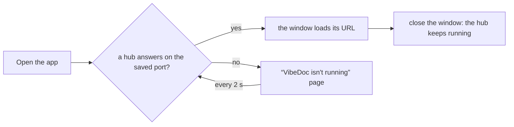

# Desktop app

VibeDoc also runs in its own window, with a Dock / taskbar icon, for people who don't want it lost among their browser tabs (R111). The window shows the same app as the browser: one codebase, and both keep working side by side.

The app lives in `desktop/`, a package of its own (Electron, pinned to one exact version). The root `package.json` doesn't depend on Electron, so `npx vibedoc` installs stay as light as before.

## Run it from source

```bash
pnpm --dir desktop install   # downloads the Electron binary (its postinstall)
pnpm --dir desktop start
```

## How it finds VibeDoc

The app doesn't start a server of its own yet. It opens the VibeDoc hub that already runs, found the way the CLI finds it: the port saved in `<home>/port` (`<home>` = `$VIBEDOC_HOME` or `~/.vibedoc`, R100), else 3333, and a probe of `GET /api/projects` there.



- **A hub answers** (`vibedoc` in a terminal, or `vibedoc start` in the background): the window loads `http://localhost:<port>/`, and the menu's first line says `Using VibeDoc at http://localhost:<port>`. No second VibeDoc starts.
- **Nothing answers**: the window shows "VibeDoc isn't running" with the command to run, and opens VibeDoc as soon as it answers.
- **Closing the window** never stops VibeDoc: the app didn't start it. On macOS the app stays in the Dock and its icon reopens the window; on Windows and Linux closing the last window quits the app.
- **Opening the app again** focuses its window instead of opening a second one.

The window remembers its size and position in the app's own folder (Electron's `userData`, e.g. `~/Library/Application Support/VibeDoc`), never in the VibeDoc home. The app's own text (the status line, the not-running page) is in English and Vietnamese, picked from the OS language (`desktop/i18n.mjs`).

## Check

```bash
pnpm build && pnpm --dir desktop install && node e2e/desktop-app.mjs
```
