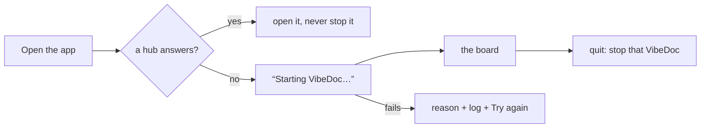
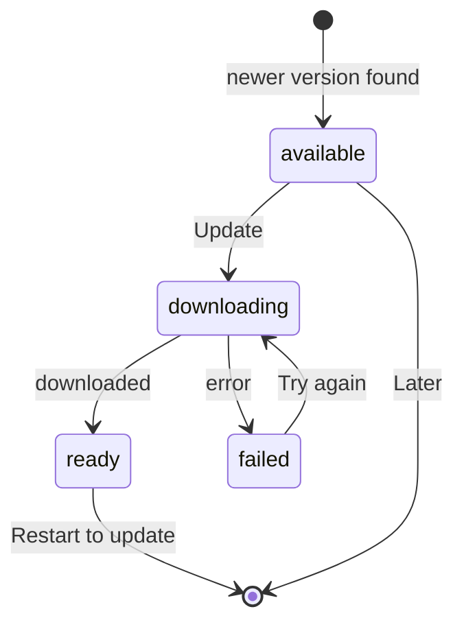

# Desktop app

VibeDoc also runs in its own window, with a Dock / taskbar icon, for people who don't want it lost among their browser tabs (R111). The window shows the same app as the browser: one codebase, and both keep working side by side.

The app lives in `desktop/`, a package of its own (Electron, pinned to one exact version). The root `package.json` doesn't depend on Electron, so `npx vibedoc` installs stay as light as before.

## Run it from source

```bash
pnpm --dir desktop install   # downloads the Electron binary (its postinstall)
pnpm --dir desktop start
```

## How it finds VibeDoc

The app first looks for a VibeDoc hub that already runs, the way the CLI does: the port saved in `<home>/port` (`<home>` = `$VIBEDOC_HOME` or `~/.vibedoc`, R100), else 3333, and a probe of `GET /api/projects` there.

<!-- vibedoc:compare -->
- **A VibeDoc already runs** — `vibedoc` in a terminal or `vibedoc start` in the background: the window opens it, the menu says `Using VibeDoc at http://localhost:<port>`, and closing or quitting the app leaves it running
- **Nothing runs** — the app starts VibeDoc itself, the menu says `VibeDoc at http://localhost:<port> · started by this app`, and quitting the app stops it

Opening the app again focuses its window instead of opening a second one. On macOS closing the window keeps the app in the Dock (and a VibeDoc it started keeps running until you quit); its icon reopens the window. On Windows and Linux closing the last window quits the app.

## Next to the terminal install

The desktop app and the terminal install (`install.sh`, npm, Homebrew) can live on one machine: whichever starts first serves the usual address, and the other uses it. `GET /api/server` says which VibeDoc answers there (`{ app: "vibedoc", version, startedBy: "cli" | "desktop" }`), and `probeAddress` in `bin/address.mjs` sorts an address into free / VibeDoc / another program.

| What holds the address | The app | `vibedoc` in a terminal |
|---|---|---|
| nothing | starts its own VibeDoc there (pinned with `--port`) | starts one, as before |
| a VibeDoc from the terminal | uses it; the menu says `Using the VibeDoc running from your terminal, vX.Y.Z` | "already running", adds the repo, exits 0 |
| a VibeDoc the app started | uses it | "already running", starts nothing |
| another program | "VibeDoc couldn't start": names the address, starts nothing | moves to the next free port and says so (R080) |

When the terminal's VibeDoc is older than the app, the app shows one quiet notification ("Your terminal VibeDoc is v1.24.0, the app is v1.26.0") and goes on using it; each install updates on its own.

## When nothing is running



The app runs `bin/vibedoc.mjs --no-open` (the CLI's foreground start) as its own child, with Electron's own Node, from the VibeDoc home folder, so the hub starts with no project and you pick one in the app. The window shows "Starting VibeDoc…" until the CLI says the app is ready, then the board. The child's output goes to `<home>/logs/desktop-server.log`.

- **The start fails** (the port is pinned by another program, the home folder can't be written, …): the window shows the reason, the last lines of the output, the log path and **Try again**.
- **Someone else starts VibeDoc at the same moment**: the CLI finds it running and says so; the app uses that one and doesn't stop it on quit.
- **Quitting the app** stops the VibeDoc it started and everything under it (agent runs, test runs): SIGTERM, then SIGKILL after 5 s (`taskkill /T /F` on Windows). A VibeDoc that dies while the app runs isn't restarted: the window says it stopped, with Try again. For a VibeDoc that restarts itself and outlives the app, run `vibedoc start` (background mode).

The window remembers its size and position in the app's own folder (Electron's `userData`, e.g. `~/Library/Application Support/VibeDoc`), never in the VibeDoc home. The app's own text (the status line, the starting and failure screens) is in English and Vietnamese, picked from the OS language (`desktop/i18n.mjs`).

## Links and notifications

- **Links to other sites** open in your default browser, never inside the VibeDoc window: an ordinary link, a `target=_blank` link and `window.open` alike. Only `http`, `https` and `mailto` links go out; `file:`, `javascript:` and other schemes do nothing. Links to VibeDoc itself stay in the window (a `target=_blank` one opens in the same window, not a second one).
- **A chat waiting on you** raises a native notification, the same one a browser tab shows when it is in the background: "needs your answer" or "plan ready", with the chat's title. The app counts as in the background when its window is hidden *or* just not focused (another app in front), and so does a browser tab now. Clicking the notification brings the window to the front on that chat.
- **The Dock / taskbar badge** shows the number in the page title's `(n) VibeDoc`: the inbox count (R105). No number, no badge.

## Installers

Each release builds the installers on its own runner per OS (`.github/workflows/desktop.yml`, dispatched by `release.yml` once semantic-release has made the GitHub release) and attaches them to the release `v<version>`:

| OS | Files |
|---|---|
| macOS | `VibeDoc-<version>-arm64.dmg`, `VibeDoc-<version>.dmg` (Intel), the matching `.zip`s (what auto-update downloads), `latest-mac.yml` |
| Windows | `VibeDoc Setup <version>.exe` (per-user, no admin), `latest.yml` |
| Linux | `VibeDoc-<version>.AppImage`, `latest-linux.yml` |

The app carries its own copy of the VibeDoc server: `desktop/scripts/dist.mjs` packs the npm package as it would be published (`npm pack`) and installs it with its production dependencies once per OS and CPU (`npm install --os --cpu`, since Next's swc and sharp ship native binaries), then electron-builder (`desktop/electron-builder.yml`) copies the right one into the app's `Resources/server`. The app runs it with Electron's own Node, so the machine needs no Node install. The version is the root `package.json`'s.

Build one locally:

```bash
pnpm build && pnpm build:playwright && pnpm build:cli   # the app VibeDoc serves
pnpm --dir desktop install
pnpm --dir desktop run dist          # this OS → desktop/dist/; --dir for just the unpacked app
```

Without signing secrets (`CSC_LINK` / `WIN_CSC_LINK`) the build is unsigned and says "unsigned build": macOS then asks you to right-click → Open the first time.

## Updates

The installed app checks for a newer release at start and every 6 hours (`desktop/updater.mjs`, electron-updater reading the `latest*.yml` the release attached). It never downloads on its own:

1. A newer version → a small card at the bottom of the window: **VibeDoc X.Y.Z is available** · **Later** · **What's new** · **Update**.
2. **What's new** opens that release's notes (the GitHub release body semantic-release wrote, the same text as CHANGELOG.md).
3. **Later** hides that version for good; the next version shows the card again. The choice is kept by the app (`update.json` in its `userData`), never in the browser.
4. **Update** downloads it, with the percentage on the card, then offers **Restart to update**. If an agent is still working in a chat, the app asks first.
5. **Restart to update** stops the VibeDoc the app started (a VibeDoc from the terminal install keeps running: it updates through `install.sh --update`, npm or Homebrew), installs the new version and reopens the app, which starts the new version's server.

If the download or the install fails, the card says so with **Try again** and **Download the new version** (that release's page on GitHub). That is always the case on macOS until the app is signed (T585): macOS installs updates only into a signed app.



The card shows only inside the app: the app's preload (`desktop/preload.cjs`) gives the page `window.vibedocDesktop`, and a browser tab has none. A check that fails (offline, no feed) is logged and shows nothing. A build run from source doesn't check; `VIBEDOC_UPDATE_FEED=<url>` points it at a generic feed (a folder with `latest-mac.yml` / `latest.yml` / `latest-linux.yml`) to try it.

## Check

```bash
pnpm build && pnpm --dir desktop install && node e2e/desktop-app.mjs
```
