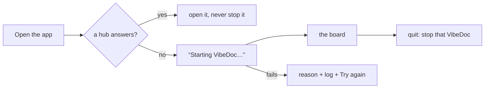

# Desktop app

VibeDoc also runs in its own window, with a Dock / taskbar icon, for people who don't want it lost among their browser tabs (R111). The window shows the same app as the browser: one codebase, and both keep working side by side.

The app lives in `desktop/`, a package of its own (Electron, pinned to one exact version). The root `package.json` doesn't depend on Electron, so `npx vibedoc` installs stay as light as before.

## Run it from source

```bash
pnpm --dir desktop install   # downloads the Electron binary (its postinstall)
pnpm --dir desktop start
```

## How it finds VibeDoc

The app first looks for a VibeDoc hub that already runs, the way the CLI does: the port saved in `<home>/port` (`<home>` = `$VIBEDOC_HOME` or `~/.vibedoc`, R100), else 3333, and a probe of `GET /api/projects` there.

<!-- vibedoc:compare -->
- **A VibeDoc already runs** — `vibedoc` in a terminal or `vibedoc start` in the background: the window opens it, the menu says `Using VibeDoc at http://localhost:<port>`, and closing or quitting the app leaves it running
- **Nothing runs** — the app starts VibeDoc itself, the menu says `VibeDoc at http://localhost:<port> · started by this app`, and quitting the app stops it

Opening the app again focuses its window instead of opening a second one. On macOS closing the window keeps the app in the Dock (and a VibeDoc it started keeps running until you quit); its icon reopens the window. On Windows and Linux closing the last window quits the app.

## When nothing is running



The app runs `bin/vibedoc.mjs --no-open` (the CLI's foreground start) as its own child, with Electron's own Node, from the VibeDoc home folder, so the hub starts with no project and you pick one in the app. The window shows "Starting VibeDoc…" until the CLI says the app is ready, then the board. The child's output goes to `<home>/logs/desktop-server.log`.

- **The start fails** (the port is pinned by another program, the home folder can't be written, …): the window shows the reason, the last lines of the output, the log path and **Try again**.
- **Someone else starts VibeDoc at the same moment**: the CLI finds it running and says so; the app uses that one and doesn't stop it on quit.
- **Quitting the app** stops the VibeDoc it started and everything under it (agent runs, test runs): SIGTERM, then SIGKILL after 5 s (`taskkill /T /F` on Windows). A VibeDoc that dies while the app runs isn't restarted: the window says it stopped, with Try again. For a VibeDoc that restarts itself and outlives the app, run `vibedoc start` (background mode).

The window remembers its size and position in the app's own folder (Electron's `userData`, e.g. `~/Library/Application Support/VibeDoc`), never in the VibeDoc home. The app's own text (the status line, the starting and failure screens) is in English and Vietnamese, picked from the OS language (`desktop/i18n.mjs`).

## Check

```bash
pnpm build && pnpm --dir desktop install && node e2e/desktop-app.mjs
```
