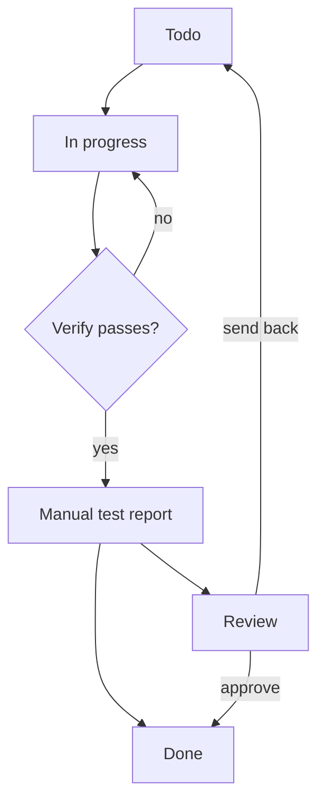
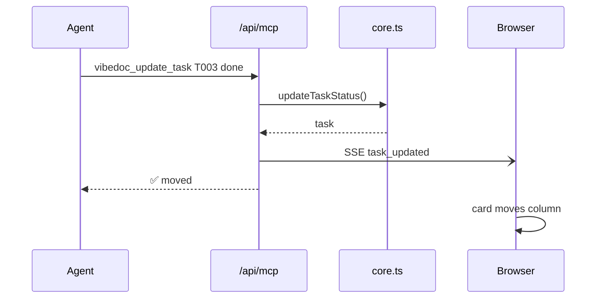
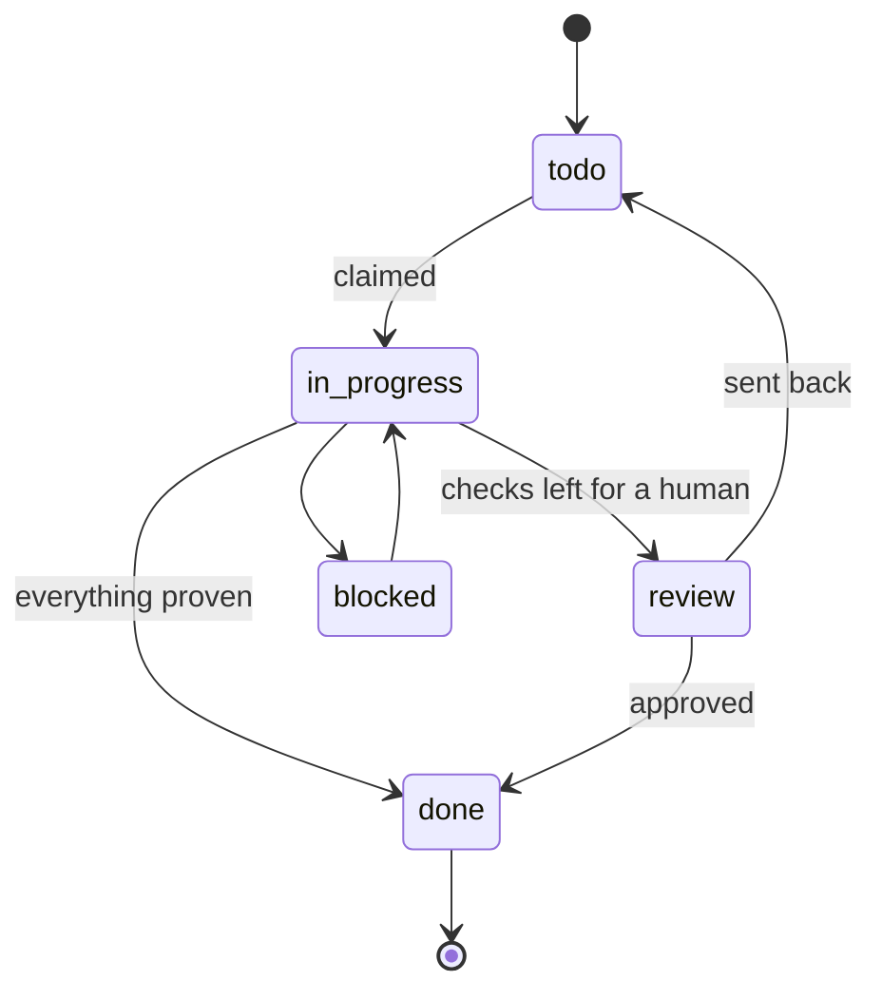
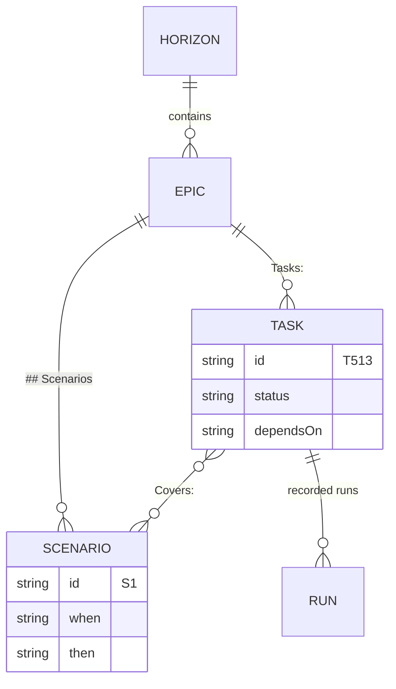

# Visual showcase

Every visual VibeDoc draws from plain markdown, on one page, using VibeDoc itself as the example. Open it in VibeDoc to see them drawn; on GitHub or through `vibedoc_read_doc` it reads as ordinary lists and code. Syntax reference: [CONVENTIONS](CONVENTIONS.md#visual-blocks).

> [!TIP]
> Hover any diagram for **Fullscreen**, **Copy image** and **Copy source**; hover a visual block for **Copy**, which keeps its look when pasted into Google Docs, Notion or Slack.

## How an agent works an epic

<!-- vibedoc:steps -->
1. **🧭 Read memory** — `vibedoc_read_memory` says what happened last session.
   The handoff, plus the knowledge entry index within the session budget.
2. **🔨 Claim** — `vibedoc_next_task` takes the next ready task and returns its full spec.
3. **🛠️ Build** — only inside the task's Scope; later tasks own the rest.
4. **🧪 Prove** — Verify passes, a manual test report, a Playwright spec for UI work.
5. **✅ Hand off** — the task moves to done (or review), and memory gets the handoff.

## What VibeDoc is made of

<!-- vibedoc:cards -->
- **📋 Board** — tasks from `plans/tasks/`, moved by people and agents alike.
- **🗺️ Roadmap** — horizons and epics from `plans/roadmap/`, with progress derived from tasks.
- **📄 Docs** — every `.md` in the repo, linked, linted and readable by agents.
- **🧠 Memory** — the session handoff and one-fact knowledge entries.
- **🧪 Test review** — checklists, recorded runs and evidence per task.
- **🤖 MCP server** — the same API for agents, at `/api/mcp`.

## Diagrams: text or files?

<!-- vibedoc:compare -->
- **Mermaid in the doc** — what VibeDoc does
  - diffs and agents read it as text
  - drawn in VibeDoc's own style, light and dark
  - less layout freedom
- **HTML/SVG diagram files** — what diagram-design produces
  - publish-quality layout
  - opaque to agents and to review
  - a second file to keep in sync

## Where visual docs came from

<!-- vibedoc:timeline -->
1. **R089** — callouts, code tabs and collapsible sections.
2. **R096** — themed diagrams, the viewer, visual blocks, copy that keeps the look.
3. **Now** — R097: diagrams drawn from the project's own data.
   Task dependencies, epic maps, doc link maps.
4. **Next** — whatever the review sends back.

## A task's life (flowchart)



## An agent moves a task (sequence)



## Task statuses (state)



## What lives where (data model)



## Install it (code tabs)

```bash title="pnpm"
pnpm dlx vibedoc
```

```bash title="npm"
npx vibedoc
```

```bash title="Demo"
npx vibedoc --demo
```

## Callouts

> [!NOTE]
> Visual blocks are a comment marker on a plain list; GitHub never shows the marker.

> [!IMPORTANT]
> The text is the source of truth: never commit HTML or SVG diagram files.

> [!WARNING]
> Keep a diagram to about 7 nodes; split it, or link to the graph, when it grows.

> [!CAUTION]
> A diagram that doesn't parse shows its error and source in place, like the one below.

```mermaid
flowchart LR
  A --> -->
```

## Drawn from the project's data

Some diagrams are never written down. Open a task with dependencies on the board (or its file here in Docs), an epic on the roadmap, or this doc's **Linked docs** panel: VibeDoc draws its dependencies, its tasks and scenarios, or its links, and agents get the same as text from `vibedoc_get_task` and `vibedoc_get_roadmap { id }`.

<details>
<summary>Why a comment marker and not a fenced block?</summary>

A fence shows up on GitHub as a grey code block, so the content looks broken outside VibeDoc. A comment marker on a normal list costs nothing anywhere else: GitHub, a diff and an agent all see the list.

</details>
