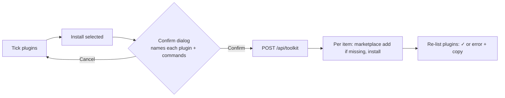

# T525: Welcome toolkit step: pick, confirm once, live ✓ or error per item
**Status:** 📋 Ready
**Phase:** R098 — Agent toolkit setup
**Size:** L
**Depends on:** T524
**Covers:** S1, S2, S3, S4

## Goal
After Connect your agent, the welcome shows "Pick your toolkit": ranked checkboxes with reasons. One confirm dialog names every plugin to be installed. Then each picked item turns ✓, or shows its real error and a command to copy, and the other picks still install.

## Context
- Epic: `plans/roadmap/R098-agent-toolkit-setup.md`
- Spec changes built here: **agent-toolkit → Confirmed install** (nothing runs until the dialog that names every plugin is confirmed) and **Install status** (✓ only from evidence; a failure shows the real error + a command).



- Decisions:
  - `POST /api/toolkit { ids: string[] }`: ids are validated against the catalog, and argv is built only from catalog data (never from the request). Guards are the same as `POST /api/agent-connect` (T251): refuse in `isDemo()`, 403 cross-site.
  - Installs run **sequentially**, and one failure never stops the rest (S4). Per item: skip `marketplace add` when `claude plugin marketplace list --json` already has it (T252 pattern), then `plugin install`.
  - ✓ comes from evidence: after the run, re-list with `pluginList`, and an item is ✓ only if it is listed there. Exit 0 alone is not enough.
  - Response: `{ results: [{ id, ok, stdout?, stderr?, missing? }] }`. `emitUpdate("toolkit", …)` after a run.
  - Already-installed items show "Installed" with a disabled checkbox (S3). Keep T252's polling (focus + every 10s while the step is open) so installs done in Claude Code tick live.
  - The step shows when the agent is Claude Code. Without `claude` on PATH, every item shows its copy commands instead of checkboxes.
- Put the picker in a shared `ToolkitPicker` component, because T3's chat card reuses it.

## Scope
- [ ] `claude-cli.ts`: `pluginInstallFrom(root, marketplace, plugin)` (generalize T252's `pluginInstall`)
- [ ] `POST /api/toolkit` with guards, sequential run, per-item result, evidence re-list
- [ ] `src/components/toolkit/ToolkitPicker.tsx` (list, reasons, matched hint, installed state, per-item result with Copy) and `ToolkitConfirmDialog.tsx` (reuse the dialog used by `DocPathDialog` / `SpecMergeDialog`)
- [ ] Welcome: `src/components/welcome/ToolkitStep.tsx` rendered after `ConnectSlot` on `src/app/(app)/start/page.tsx`
- [ ] i18n en + vi in `src/i18n/welcome.ts`
- [ ] Stub: `e2e/fixtures/claude-stub/claude` supports installing any `<id>@<mkt>` (adds it to the list) and a fail-list mode (exit 1 with a stderr) for chosen ids
- [ ] e2e `e2e/toolkit.mjs`
- [ ] CLAUDE.md "No database" list: VibeDoc runs `claude plugin marketplace add` / `plugin install` for catalog plugins only after the user confirms

**Out of scope:** the chat path (T3), removing or updating plugins, a Settings page (epic out of scope).

## Files
- `src/lib/claude-cli.ts`, `src/app/api/toolkit/route.ts`
- `src/components/toolkit/ToolkitPicker.tsx`, `src/components/toolkit/ToolkitConfirmDialog.tsx`: new
- `src/components/welcome/ToolkitStep.tsx`: new; `src/app/(app)/start/page.tsx`
- `src/i18n/welcome.ts`, `CLAUDE.md`
- `e2e/fixtures/claude-stub/claude`, `e2e/toolkit.mjs`: new

## Acceptance criteria
- [ ] S1: on a project with a web frontend the step lists frontend-design and example-skills first, each with its reason
- [ ] S2: tick 2 → Install → the dialog names both plugins and their commands; Cancel → stub argv log empty; Confirm → only those 2 are installed
- [ ] S3: a plugin already in the stub's list shows "Installed" and can't be ticked
- [ ] S4: 3 picked, one set to fail → 2 ✓, the failed one shows the stub's stderr and a copyable command
- [ ] POST with an id not in the catalog → 400; a foreign Origin → 403
- [ ] `e2e/toolkit.mjs`, `e2e/first-screen.mjs` and `e2e/i18n.mjs` pass

## Verify
```bash
node src/lib/toolkit.check.mts && node src/lib/i18n.check.mts
pnpm lint && pnpm build
PATH=$PWD/e2e/fixtures/claude-stub:$PATH PORT=3081 pnpm dev:next &
BASE=http://localhost:3081 node e2e/toolkit.mjs
BASE=http://localhost:3081 PW_DIR=. node e2e/first-screen.mjs
```

## Manual tests
_2026-10-13 — human_
### Steps
- [ ] S1 — WHEN the welcome shows the toolkit step for a project with a web frontend → THEN frontend-related plugins are listed first, each with a one-line reason
- [ ] S2 — WHEN the user ticks plugins and confirms → THEN only the ticked plugins are installed, and the dialog named each one before anything changed
- [ ] S3 — WHEN a catalog plugin is already installed → THEN it shows as installed and cannot be ticked again
- [ ] S4 — WHEN one plugin fails to install → THEN that item shows the real error and a command to copy, and the other picks still install
