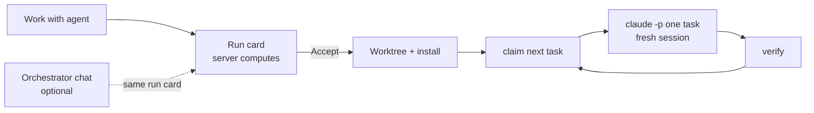

# T552: ADR-007: workers, run cards and the orchestrator
**Status:** 📋 Todo
**Phase:** R108 — Agent runs in a worktree
**Size:** S (~1 hr)
**Depends on:** T566

## Goal
Write down the decisions behind R108 once, with the spike's evidence, so every later task (and the next agent) builds the same model instead of re-deciding it.

## Context
- Epic: `plans/roadmap/R108-agent-runs-in-worktree.md`; the spike's findings (T566) are § Spike of the same ADR.
- Decisions (state each with the rejected option and why):
  - **The server drives a worker task by task.** It claims the next task (`claimNextTask` in core), runs `claude -p "/vibedoc:work <task>"` in a **fresh session**, and repeats. Rejected: one `claude -p` for the whole epic (context grows and compacts, a crash loses the whole run, no checkpoint).
  - **Routing is deterministic.** "Work with agent" shows a run card the server computes (epic has a worker → send to it; else new worktree). Rejected: an LLM orchestrator deciding every run (seconds of latency, tokens, different answers for the same input, a busy chat refuses the next trigger).
  - **The orchestrator is an optional chat** per project, for overview and fuzzy requests; it proposes with the same run card and never starts anything. Rejected: orchestrator as the only entry point.
  - A **worker is a chat** with a worktree. Rejected: a separate "agent runs" store/page.
  - "Existing session" = a worker VibeDoc spawned. Not the user's terminal sessions.
  - One worker per epic; parallel across epics only.
  - Worktrees in `<home>/worktrees/<project>/<branch-slug>`; rejected: sibling folders, in-repo `.vibedoc/worktrees/`.
  - The worker's MCP points at the **main checkout** (`?root=`), `--strict-mcp-config` (R104's `${PWD}` header would point at the worktree).
  - **The allowlist is not a sandbox.** `Bash(pnpm *)` runs any package script, so a worker can run arbitrary code as the user. Mitigations: a minimal env (no tokens or keys passed through), worktree outside the repo, push denied, a budget per task. A real sandbox is out of scope.
  - Each task is **verified** (R067) before the next one starts.
  - Each worker gets its own dev server port.



## Scope
- [ ] `docs/architecture/decisions/ADR-007-orchestrator-and-workers.md`: context, decisions, consequences, rejected options; keep T566's § Spike
- [ ] Format: copy `docs/architecture/decisions/ADR-006-one-agent-connection.md`

**Out of scope:** any code.

## Files
- `docs/architecture/decisions/ADR-007-orchestrator-and-workers.md`

## Acceptance criteria
- [ ] Every bullet in Context appears as a decision with its rejected option
- [ ] Where the spike contradicted a bullet, the ADR follows the spike and says so
- [ ] `vibedoc check` reports no error for the ADR

## Verify
```bash
pnpm build:cli && node bin/vibedoc.mjs check --root .
```
