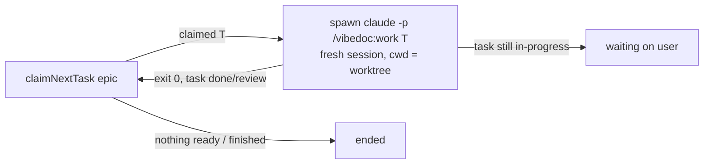

# T554: Worker backend: task-by-task loop in a worktree
**Status:** 📋 Todo
**Phase:** R108 — Agent runs in a worktree
**Size:** L (half a day)
**Depends on:** T553, T566
**Covers:** S1, S2

## Goal
`POST /api/workers` creates a worktree for an epic and the server works through it one task at a time: claim the next ready task, run `claude -p "/vibedoc:work <task>"` in a fresh session inside the worktree, then the next, with board updates landing in the main project.

> [!WARNING]
> Spike T566 (ADR-007 § Spike): `/vibedoc:work` runs headless with `--plugin-dir`, so no `--append-system-prompt` fallback. Default setting sources leak the user's hooks, plugins and 78 tools, so the worker argv adds `--setting-sources project,local` and `--tools "Bash,Edit,Write,Read,Glob,Grep"` (the project CLAUDE.md still loads). The worker prompt must say: commit code only, never `plans/tasks/*` (the skill tried to stage the task file, which lives in the main checkout).

## Context
- Epic: `plans/roadmap/R108-agent-runs-in-worktree.md`, ADR-007 (incl. § Spike: use its argv and findings, not this file's, where they differ)
- The loop:



- Claim: `claimNextTask` (`src/lib/core.ts:1884`, pure pick in `src/lib/work-queue.ts`) with owner `ai:worker-<id>`, the same thing `vibedoc_next_task` does. The agent gets a task that is already in-progress and owned by it.
- The work skill takes only an epic today (`plugin/skills/work/SKILL.md:10`). Add a **task mode**: argument `T123` → the task is already claimed (or claim it with `vibedoc_get_task` + `vibedoc_update_task in-progress`), do steps 2–5 once, stop, never call `vibedoc_next_task`. Keep `plugin.json` `version` = package.json `version`.
- Argv: template `src/app/api/chat/route.ts:84-139`, but a worker **differs**:

| Flag | Chat | Worker |
|---|---|---|
| `cwd` | root | worktree dir |
| `--mcp-config` | `?root=<root>` + `x-vibedoc-chat` | `?root=<main root>` + `x-vibedoc-worker: <id>` |
| `--strict-mcp-config` | yes | yes |
| `--tools ''`, `--setting-sources ''`, `--disable-slash-commands` | yes | **no** (needs Edit/Bash, CLAUDE.md, the skill) |
| `--plugin-dir` | — | VibeDoc's own `plugin/` |
| `--allowedTools` | `mcp__vibedoc__*` | the spike's list (hardcoded here, a setting in T557) |
| `--disallowedTools` | write/delete doc… | `Bash(git push*) Bash(gh *)` |
| `--resume` | the chat's session | **none**: each task starts fresh |

- Never `--permission-mode bypassPermissions`.
- A worker is a chat (ADR-007): `.vibedoc/chats/<id>.json` with `worker: { dir, branch, base, target: Attach, phase, turns: [{taskId, sessionId, startedAt, endedAt, result}] }`; `attach` = the epic. The chat shows one divider per task.

## Scope
- [ ] Work skill: task mode (one task, stop)
- [ ] Pure `src/lib/worker-args.ts`: `workerArgs({task, mainRoot, mcpOrigin, workerId, pluginDir, allowed, denied})` → argv; self-check (no `--tools ''`, no `--resume`, `?root=` = main root, push denied)
- [ ] Pure `src/lib/worker-loop.ts`: `nextStep(worker, claimResult, lastTurn)` → `run-task | wait-user | ended`; self-check
- [ ] `src/lib/chats.ts`: `Worker` type + `worker?` on `Chat`, kept by `toSaved` / `fromSaved`
- [ ] `src/lib/worker-runs.ts` (process only, globalThis like `test-runner.ts`): spawn in its own group, cancel kills the group (`killGroup`, `src/lib/test-runner.ts:26`), one loop per worker
- [ ] `POST /api/workers {target: {kind: "epic", id}, branch?, base?}`: same-origin, `playgroundForbidden()` / `demoForbidden()`, one worker per epic (409), `createWorktree` + `installWorktreeDeps` (T553), save the chat, start the loop; stream via `chat-turns.ts` keyed by the main root; `emitUpdate('worker_updated')` on each step
- [ ] `POST /api/workers/cancel {id}`: kill the current task, the task stays in-progress, phase = stopped
- [ ] MCP route: `x-vibedoc-worker` calls don't count as "agent connected"; `vibedoc_get_frontend` for a worker answers "No frontend for a worktree yet: keep the report manual" (until T559)
- [ ] Stub `e2e/fixtures/claude-stub/claude`: a worker task turn = stream-json, write a file, commit it in its cwd, `vibedoc_update_task done` on the MCP URL in `--mcp-config`

**Out of scope:** UI (T555); surviving a restart (T556); settings, env and limits (T557); budget and usage limits (T567); questions (T558); verify gate (T568); UI spec runs in a worker (T559); starting from a single task (T560).

## Files
- `plugin/skills/work/SKILL.md`, `plugin/.claude-plugin/plugin.json`
- `src/lib/worker-args.ts`, `src/lib/worker-loop.ts` (+ `.check.mts`) — new
- `src/lib/worker-runs.ts` — new
- `src/app/api/workers/route.ts`, `src/app/api/workers/cancel/route.ts` — new
- `src/lib/chats.ts`, `src/lib/agent-connect.ts` (`WORKER_CALL_HEADER`), `src/app/api/mcp/route.ts`
- `e2e/fixtures/claude-stub/claude`, `e2e/worker-run.mjs` — new

## Implementation notes
- The plugin dir: resolve from VibeDoc's install folder, the way `readPlanningSkill()` finds `plugin/skills/`.
- A turn that exits 0 while its task is still in-progress means the agent stopped without finishing (a question comes in T558): phase `wait-user`, never claim the next one.
- Per-task sessions also keep each task's commits separate, which the finish view (T563) lists.

## Acceptance criteria
- [ ] With the stub on PATH, an epic with two ready tasks → two stub calls, each with a different task id and no `--resume`, two commits on `vibedoc/<epic>`, main checkout `git status` shows no code change (S1)
- [ ] Each task moves on the board while the stub runs (SSE, main checkout's task files) (S2)
- [ ] The stub's argv (`.claude-stub.log`) has `?root=<main root>`, `--strict-mcp-config`, `Bash(git push*)` denied, no `--tools`
- [ ] Cancel mid-task → the process group is gone, no next task is claimed
- [ ] Playground/demo → 403; a second worker for the same epic → 409

## Verify
```bash
node src/lib/worker-args.check.mts && node src/lib/worker-loop.check.mts && node src/lib/chats.check.mts
pnpm lint && pnpm build
BASE=http://localhost:3081 node e2e/worker-run.mjs   # server started with e2e/fixtures/claude-stub first on PATH
```

## Manual tests
- [ ] S1 — WHEN the user accepts a run card for a new worktree → THEN a new worktree and branch exist, the worker's commits land only there, and the user's checkout has no code changes
- [ ] S2 — WHEN the worker claims and finishes a task in the worktree → THEN the card moves on the board in real time, like a terminal session
- [ ] In Claude Code, `/vibedoc:work T<id>` on a real task → the agent does only that task and stops
