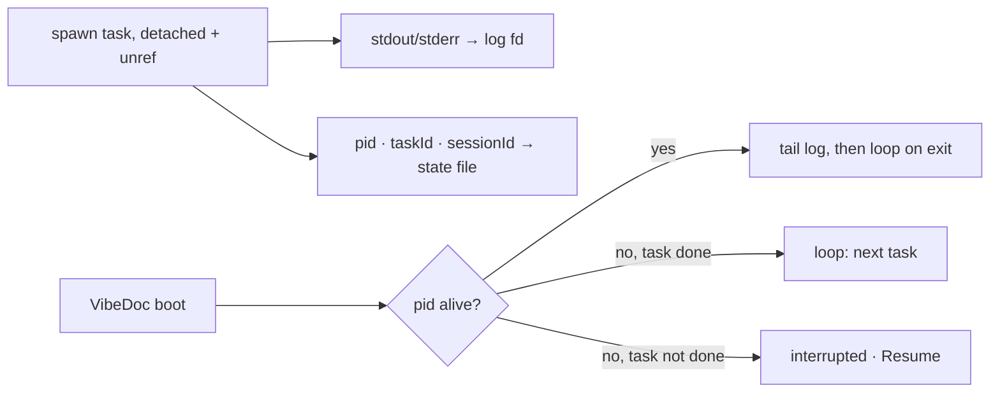

# T556: Worker survives a restart
**Status:** 👀 Review
**Phase:** R108 — Agent runs in a worktree
**Size:** M (2–3 hrs)
**Depends on:** T554, T558
**Covers:** S5
**Owner:** ai:claude
**Due:** 2026-10-23
**Started:** 2026-10-20

## Goal
A worker keeps running when VibeDoc restarts: the current task's process goes on, the page follows it again, and the next task still starts. If the process died, the worker shows as interrupted with Resume.

> [!WARNING]
> Spike T566: `--resume <id>` finds the session from **any** cwd and then runs in that cwd. Always spawn a resume with cwd = the worktree; that is the only guard against a worker editing the user's checkout. A resume re-reads the whole session (115k cache tokens in the spike), so resume only an interrupted task, never as the loop.

## Context
- Epic: `plans/roadmap/R108-agent-runs-in-worktree.md`, ADR-007
- Smaller than it was: the server's loop (T554) means only **one task's** process must outlive the server, and the loop restarts from the files.



- Files per worker under `<home>/worktrees/<project>/.vibedoc-workers/<id>.ndjson` + `<id>.json`, never inside the worktree (the agent would see and commit them).
- Rule: only core.ts touches fs → core opens the log fd and reads/tails it; `src/lib/worker-runs.ts` spawns with `stdio: ['ignore', fd, fd]`, `detached`, `unref()`.
- The server writes the turn's result into `.vibedoc/chats/<id>.json` itself (phase, last reply), so status and the inbox are right with no tab open. `chat-turns.ts`'s `ponytail:` comment names this upgrade; plain chats keep the in-memory turns.
- Resume an interrupted task: `--resume <that task's sessionId>` from the **same worktree cwd** (Claude Code keys sessions by folder; see T566), prompt "Continue task <id>."

## Scope
- [ ] core: `openWorkerLog`, `readWorkerLog(id, offset)`, `writeWorkerState`, `readWorkerStates(root)`
- [ ] Pure `src/lib/worker-state.ts`: `workerPhase(state, alive, taskStatus)` → running | between-tasks | interrupted | ended; session id from the `system/init` line; self-check
- [ ] `worker-runs.ts`: detached spawn into the fd; `isAlive(pid)`; on boot (first request per root) re-adopt every worker
- [ ] `GET /api/workers/stream?id=` replays the log file then follows it; workers stop using chat-turns' memory
- [ ] `POST /api/workers/resume {id}` for an interrupted task
- [ ] CLAUDE.md: add `<home>/worktrees/<project>/.vibedoc-workers/` to the outside list

**Out of scope:** making plain chats survive a restart.

## Files
- `src/lib/worker-state.ts` (+ check) — new
- `src/lib/worker-runs.ts`, `src/lib/core.ts`
- `src/app/api/workers/stream/route.ts`, `src/app/api/workers/resume/route.ts` — new
- `src/context/ChatContext.tsx`, `CLAUDE.md`
- `e2e/worker-restart.mjs` — new

## Acceptance criteria
- [ ] Restart the dev server mid-task (slow stub turn) → the chat shows the output before and after, in order, and the next task starts after the restart (S5)
- [ ] Kill the stub while VibeDoc is down → after start: "Interrupted" + Resume; Resume passes `--resume <that task's session>` with cwd = the worktree (S5)
- [ ] With every tab closed, a task's end updates `.vibedoc/chats/<id>.json`
- [ ] Nothing new appears inside the worktree apart from the agent's own work

## Verify
```bash
node src/lib/worker-state.check.mts
pnpm lint && pnpm build
node e2e/worker-restart.mjs   # starts and restarts its own server with the stub on PATH
```

## Manual tests
_2026-10-20 — ai_
### Steps
- [ ] S5 — WHEN VibeDoc restarts while a worker runs → THEN the worker keeps going (including the next task) and the page follows it again, or it shows as interrupted with Resume, never silently lost
- [ ] Start a worker on an epic with 2+ tasks (Work with agent), stop VibeDoc (Ctrl-C) mid-task, start it again and open /chat → the worker's chat shows the current task's output, its reply, then the next task's divider; the board card moves to done
- [ ] Stop VibeDoc mid-task, kill the `claude -p` process (pid in `~/.vibedoc/worktrees/<project>/.vibedoc-workers/<id>.json`), start VibeDoc and open the worker chat → the strip says "Interrupted" with a Resume button
- [ ] Click Resume → the chat adds "Continue task T…", the agent continues in the worktree (not your checkout) and the task ends done
- [ ] Inside the worker's worktree, `git status` → only the agent's own changes; no `.vibedoc-workers` folder or `.ndjson` file
### Regression risk
- [ ] Reload /chat while a worker runs (no restart) → it re-attaches to the running task and shows its reply
- [ ] A worker that asks a question (question card) still waits on you and resumes on Submit, not "Interrupted"
- [ ] Stop on a running worker still kills its task
