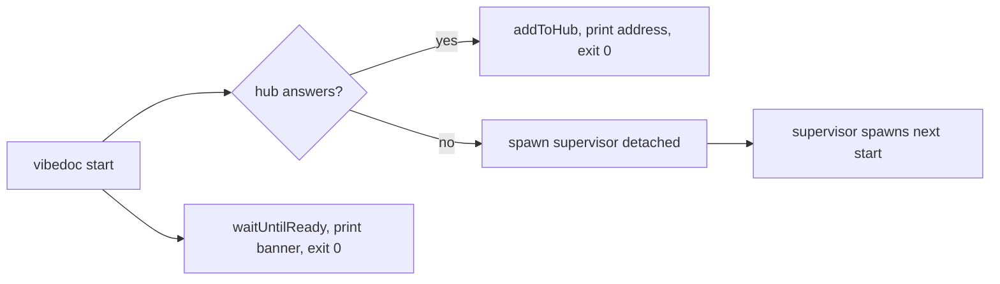

# T569: `vibedoc start`: background supervisor, state file, reuse a running VibeDoc
**Status:** 👀 Review
**Phase:** R109 — Background mode
**Size:** L
**Depends on:** —
**Covers:** S1, S2
**Owner:** ai:worker-c-mvgtml325ef8
**Due:** 2026-10-27
**Started:** 2026-10-20

## Goal
`vibedoc start` launches VibeDoc in the background through a small supervisor, prints the address and gives the terminal back. A second `start` reuses the running VibeDoc and never starts another one.

## Context
- Epic: `plans/roadmap/R109-background-mode.md`. This task builds spec ADDED `Background start` (cli-startup), scenario "Second start".
- Decision: a small Node supervisor, `bin/supervisor.mjs`. `vibedoc start` spawns it `detached` with `unref()` and `windowsHide: true`, with stdio sent to the log file. The supervisor spawns `next start` the way `bin/vibedoc.mjs` does today (same env: `VIBEDOC_ROOT`, `PORT`, `VIBEDOC_HOME`). This task covers start only; crash restart is T4.
- Must work on macOS, Linux and Windows: Node APIs only, no shell scripts.
- State file `<home>/server.json`, where `<home>` is `VIBEDOC_HOME` or `~/.vibedoc`. The supervisor writes it, and later tasks read it. Shape (pinned here, T2–T4 rely on it):
  `{ supervisorPid, serverPid, port, startedAt, log, state: "starting"|"running"|"crashed"|"stopped", restarts: [], lastError: null }`
- Log file: `<home>/logs/server.log`, appended to. Move it to `server.log.1` when it is over 5 MB at start.
- Reuse: before spawning, `resolveAddress` / `probeVibedoc` (`bin/address.mjs`) tell whether a hub already answers. If one does, `addToHub(port, cwd)` (T534), print "VibeDoc is already running at …" plus the banner, and exit 0. This applies whether the running copy is in the background or in the foreground.
- The CLI reads `server.json` from bin, not from core. That follows the precedent of bin deleting `.vibedoc/port` (T535), and the file is not project data. Add `<home>/server.json` and `<home>/logs/` to CLAUDE.md's list of files outside the project.
- Plain `vibedoc` (foreground) stays as it is today.



## Scope
- [ ] `bin/supervisor.mjs`: new. Spawns `next start` with output to the log, and writes `server.json` (starting → running once `waitUntilReady` says ready).
- [ ] `bin/vibedoc.mjs`: dispatch `start` before the foreground path, like `check` (T420). The `--port`, `--no-open` and `--root` handling stays the same.
- [ ] `start` waits with `waitUntilReady` (T233), prints "✓ VibeDoc is running in the background at http://localhost:<port>" plus the existing banner (MCP URL, connect command), opens the browser unless `--no-open`, and exits 0.
- [ ] A start failure (the child exits before it is ready) prints the reason and the tail of the log, exits non-zero, and sets `state: "stopped"` with `lastError`.
- [ ] `bin/server-state.mjs`: new, with `readServerState(home)`, `writeServerState(home, patch)` (atomic: write to tmp, then rename) and `isAlive(pid)` (`process.kill(pid, 0)`).
- [ ] `docs/getting-started.md` and the site's CLI/getting-started page: a short "Run in the background" section about `vibedoc start`.
- [ ] CLAUDE.md: the outside-files list.

**Out of scope:** `status` (T2), `stop` (T3), crash restart (T4), start at login (R110).

## Files
- `bin/supervisor.mjs`: new
- `bin/server-state.mjs` (+ `bin/server-state.check.mts`): new
- `bin/vibedoc.mjs`, `bin/address.mjs`
- `e2e/background-mode.mjs`: new. It uses a temp `VIBEDOC_HOME`, a fixed `PORT` and `--no-open`. Later tasks extend it.
- `docs/getting-started.md`, the site docs page, `CLAUDE.md`

## Implementation notes
- On Windows, `detached: true` alone opens a console window. Also set `windowsHide: true`, and open the log fd before spawning (`stdio: ['ignore', fd, fd]`).
- `start` must exit even though the supervisor lives on, so call `unref()` and close every handle to it.
- Reuse the existing banner function; don't duplicate its text.

## Acceptance criteria
- [ ] S1: `e2e/background-mode.mjs` runs `vibedoc start --no-open`, which exits 0 within 60 s. The parent process exits, and `GET /api/projects` on the printed port still answers 200.
- [ ] S2 / spec "Second start": a second `vibedoc start` (in the same repo or another one) exits 0 and prints the same address. `server.json` still holds the same `supervisorPid`, only one process listens on the port, and the second repo shows up in `/api/projects`.
- [ ] A start failure prints the reason and exits non-zero, and `server.json` shows `stopped` with `lastError`.
- [ ] `node bin/server-state.check.mts` covers write/read round trip, a missing file, and `isAlive` for its own pid and for a dead pid.
- [ ] Plain `vibedoc` still runs in the foreground, and Ctrl+C stops it.

## Verify
```bash
node bin/address.check.mts && node bin/server-state.check.mts
pnpm lint && pnpm build
node e2e/background-mode.mjs
```

## Verification
_2026-10-20 — ai:claude · at 0079cc3_
- [minor] Scope: a start failure "sets state: stopped" (supervisor timeout path) — On its own 60 s timeout the supervisor sends SIGTERM to `next` and exits at once, writing serverPid: null. If `next` doesn't exit on SIGTERM, it keeps running with no recorded pid. vibedoc.mjs's 75 s fallback then can't SIGKILL it, because it reads serverPid from server.json. Wait for the child's exit, or keep serverPid until it exits. · `bin/supervisor.mjs:322-325`
- [minor] AC S1 / S2 / failure / `node bin/server-state.check.mts` / foreground Ctrl+C — Not verified: running `node bin/server-state.check.mts` and `e2e/background-mode.mjs` was not permitted in this session. I checked the code and test coverage by reading only. The check covers round trip, missing file and isAlive (own pid and dead pid), and the e2e covers S1, S2, the race, foreground Ctrl+C and a failed start.

## Manual tests
_2026-10-20 — ai_
### Steps
- [ ] S1 — WHEN the user runs `vibedoc start` and closes the terminal → THEN VibeDoc keeps answering at the printed address
- [ ] S2 — WHEN the user runs `vibedoc start` while VibeDoc already runs → THEN no second copy starts, and the terminal prints the running one's address
- [ ] In a repo, run `vibedoc start` → it prints "✓ VibeDoc is running in the background at http://localhost:<port>", the MCP URL + connect command and the log path, opens the browser, and the prompt comes back
- [ ] Open `~/.vibedoc/server.json` → `state: "running"`, a `supervisorPid` and `serverPid`, the port; `~/.vibedoc/logs/server.log` has the Next output and "supervisor: running on …"
- [ ] With VibeDoc stopped, run `vibedoc start` in two terminals at once → one prints "running in the background", the other "Another VibeDoc is starting, waiting for it..." then "already running at <same address>"; `~/.vibedoc/server.lock` is gone afterwards
- [ ] On Windows: `vibedoc start` opens no extra console window and the server survives closing the terminal
### Regression risk
- [ ] Plain `vibedoc` still runs in the foreground, prints "Press Ctrl+C to stop the server", and Ctrl+C stops it
- [ ] `vibedoc --demo` still works (and `vibedoc start --demo` refuses with a clear message)
