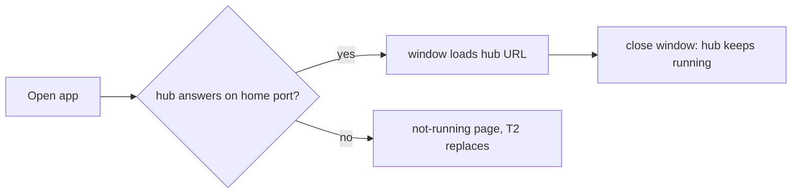

# T577: Electron shell opens the running VibeDoc in its own window
**Status:** 👀 Review
**Phase:** R111 — Desktop app window
**Size:** L
**Depends on:** —
**Covers:** S2
**Owner:** ai:claude
**Due:** 2026-10-27
**Started:** 2026-10-20

## Goal
A `desktop/` Electron app opens the VibeDoc that is already running (plain `vibedoc` today, `vibedoc start` once R109 ships) in its own window with a Dock / taskbar icon. Closing the window leaves that VibeDoc running. This is the thin end-to-end slice the later tasks widen.

## Context
- Epic: `plans/roadmap/R111-desktop-app-window.md`
- Decision: **Electron**, in its own package `desktop/` (its own `package.json`, `electron` pinned to one exact version like `next`). The root `package.json` does not gain `electron`, so `npx vibedoc` installs stay as light as today.
- Decision: plain ESM `.mjs` main process, no build step, the same style as `bin/`.
- Decision: the app **probes** for a running VibeDoc and does not wait on R109. It reads `<home>/port` (R100; `<home>` = `VIBEDOC_HOME` or `~/.vibedoc`) and checks that a hub answers, reusing `probeVibedoc` / `resolveAddress` from `bin/address.mjs`. That works with a foreground `vibedoc` today and with R109's background one (T569 keeps the same port and address).
- The window loads the hub URL (`http://localhost:<port>/`) directly. The UI is the same Next app the browser uses: one codebase and no fork, so both keep working.
- "Says so": the app menu shows a disabled status line, e.g. "Using VibeDoc at http://localhost:3333". T2 adds the "started by this app" variant.
- Nothing running yet → this task only shows a short "VibeDoc isn't running. Run `vibedoc` in a terminal" page. T2 replaces that page with starting VibeDoc itself.
- The app's own text (status line, fallback page) comes in `en` + `vi`, picked from `app.getLocale()`. It can't use `useT()` because it is outside Next, but it follows the same rule of no hardcoded single-language text.



## Scope
- [ ] `desktop/package.json`: `electron` (exact pin) and `playwright` for its e2e; scripts `start` and `test:e2e`
- [ ] `desktop/main.mjs`: single-instance lock, one `BrowserWindow` (remembers its size), app icon, loads the hub URL once the probe says ready
- [ ] Application menu: the standard Edit / View / Window menus (so copy, paste and reload work) plus the status line
- [ ] macOS: closing the last window keeps the app in the Dock; clicking the Dock icon reopens it. Windows / Linux: closing the last window quits the app. Neither ever stops a VibeDoc the app didn't start.
- [ ] `desktop/not-running.html`: the fallback page (en / vi)
- [ ] `docs/desktop-app.md`: new; how to run the app from source (`pnpm --dir desktop install && pnpm --dir desktop start`) and how it finds VibeDoc
- [ ] CLAUDE.md repo structure: a `desktop/` line

**Out of scope:** starting VibeDoc from the app (T2), external links and notifications (T3), installers, signing and updates (R112), a tray icon.

## Files
- `desktop/package.json`, `desktop/main.mjs`, `desktop/not-running.html`, `desktop/icons/`: new
- `bin/address.mjs`: export whatever the app needs to import. Keep it free of anything Electron-specific.
- `e2e/desktop-app.mjs`: new; later tasks add sections
- `docs/desktop-app.md`: new; `CLAUDE.md`

## Implementation notes
- Import the probe from `../bin/address.mjs` rather than copying it. If it reads env or cwd at import time, pass `home` and `port` as arguments instead.
- `webPreferences`: `contextIsolation: true`, `nodeIntegration: false`, no preload for now. The page is a normal web page.
- e2e: `import { _electron } from 'playwright'`; launch with a temp `VIBEDOC_HOME`, start a foreground hub first (copy the setup in `e2e/stable-address.mjs`), then launch the app and assert that the window URL is the hub's.

## Acceptance criteria
- [ ] S2: with a hub running, opening the app shows the board in a window titled VibeDoc. `e2e/desktop-app.mjs` asserts the window URL is the hub's and that only one process listens on the port.
- [ ] Closing the window (and on Windows / Linux, quitting the app) leaves the hub answering `GET /api/projects` 200 (e2e).
- [ ] Opening the app a second time focuses the existing window instead of opening another one.
- [ ] The menu status line names the address in use.
- [ ] `npm run build` and lint still pass. The root `package.json` has no `electron`.

## Verify
```bash
node bin/address.check.mts
pnpm lint && pnpm build
pnpm --dir desktop install && node e2e/desktop-app.mjs
```

## Manual tests
_2026-10-20 — ai_
### Steps
- [x] S2 — WHEN VibeDoc already runs in the background and the user opens the app → THEN the app shows it, no second VibeDoc starts, and closing the app leaves it running
- [ ] Run `vibedoc start`, then `pnpm --dir desktop start` → a VibeDoc window opens on the board, with the VibeDoc icon in the Dock
- [ ] Open the VibeDoc menu → the first line reads "Using VibeDoc at http://localhost:3333" (greyed out)
- [ ] Close the window (macOS) → the app stays in the Dock; click its icon → the window comes back at the same size and place
- [ ] With nothing running, open the app → "VibeDoc isn’t running" with `vibedoc start`; run it in a terminal → the window opens the board within a few seconds
- [ ] Copy / paste in a doc editor and ⌘R reload work in the window
- [ ] On a Vietnamese macOS → the menu line and the not-running page are in Vietnamese
### Regression risk
- [ ] The same project open in a browser tab still works next to the app
- [ ] _`e2e/desktop-app.mjs` (passing) proves S2 (window URL = hub, one listener on the port, hub answers after close and quit), the single window on a second launch, the menu status line and the not-running → hub switch. Screenshots checked: the board in the window, the not-running page in vi. Windows / Linux not run._
