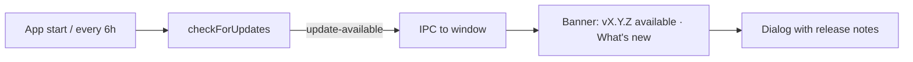

# T582: Update check: the app says a new version exists and shows its release notes
**Status:** 👀 Review
**Phase:** R112 — Desktop installers & auto-update
**Size:** M
**Depends on:** T581
**Covers:** S2
**Owner:** ai:claude
**Due:** 2026-10-23
**Started:** 2026-10-20

## Goal
When a newer release exists, the desktop app tells the user and shows that release's notes, without downloading anything until they ask.

## Context
- Epic: `plans/roadmap/R112-desktop-installers-auto-update.md`
- Decision: electron-updater with the GitHub provider (feeds come from T-builds). `autoDownload = false`, because the epic rules out silent updates.
- Release notes are the GitHub release body that semantic-release writes. It's the same text as `CHANGELOG.md`.
- The window shows the same Next UI as the browser (R111), so the banner has to render only when running inside the app (preload exposes `window.vibedocDesktop`).



## Scope
- [ ] Main process: `desktop/src/updater.ts` checks on startup (after the window is ready) and every 6 h. Packaged builds only, skipped in dev
- [ ] Forward `update-available` (version, releaseNotes, releaseDate) to the renderer over IPC. The preload exposes `vibedocDesktop.onUpdate(cb)` and `vibedocDesktop.checkForUpdates()`
- [ ] UI: a small banner/toast "VibeDoc X.Y.Z is available" with **What's new**, which opens a dialog that renders the notes as markdown, and **Later**, which hides it until the next version
- [ ] Show nothing in the browser (no `window.vibedocDesktop`)
- [ ] Network or feed errors are logged and never shown as a blocking error

**Out of scope:** download and install (T-install). The install button is added there.

## Files
- `desktop/src/updater.ts`: new
- `desktop/src/preload.ts`: expose the update API
- `src/components/…/DesktopUpdateBanner.tsx`: new, mounted in the app shell layout

## Implementation notes
- Reuse the existing markdown renderer the docs view uses for the notes.
- Keep the "Later" dismissal per version in `localStorage`.

## Acceptance criteria
- [ ] A packaged app on version N, with release N+1 published (or a local feed via `dev-app-update.yml` + `forceDevUpdateConfig`), shows the banner within a few seconds of starting
- [ ] What's new shows the N+1 release notes
- [ ] The same UI in a browser tab shows no banner
- [ ] Offline start: no banner, no error dialog
- [ ] Unit test for the renderer component (banner hidden without `vibedocDesktop`, shown with a fake update event)

## Verify
```bash
pnpm test
pnpm run build
pnpm --dir desktop run dist
# run the packaged app against a local feed with a higher version → banner + notes
```

## Manual tests
_2026-10-20 — ai_
### Steps
- [ ] S2 — WHEN a newer release exists → THEN the app says so with its release notes, and one click installs it and reopens the app on the new version
- [ ] Install an older packaged build, publish (or serve via VIBEDOC_UPDATE_FEED) a newer one, open the app → within a few seconds a card at the bottom: "VibeDoc X.Y.Z is available · Later · What’s new"
- [ ] What’s new → a dialog "What’s new in VibeDoc X.Y.Z" with the release notes and its date
- [ ] Later → the card goes, and stays gone after a restart; a still newer version shows it again
- [ ] The same VibeDoc in Chrome → no card
- [ ] Start the app with Wi-Fi off → no card and no error dialog
- [ ] Vietnamese UI → "Đã có VibeDoc X.Y.Z · Để sau · Có gì mới"
### Regression risk
- [ ] The first-run feedback card and the Help button (bottom right) still show and don’t overlap the update card
- [ ] _`e2e/desktop-app.mjs` section 7 passes: a local generic feed at 99.0.0 → the banner, What’s new shows the notes, Later keeps it hidden after a reload; a Chrome tab has no `window.vibedocDesktop` and no banner; an unreachable feed → no banner, one window. `node desktop/update-notes.check.mjs` passes (notes from a string / list, Later per version). Screenshots checked (banner centred at the bottom, notes dialog). Not run: a real GitHub release feed. Deviation: the task said localStorage for Later; CLAUDE.md bans it, so the app keeps it in its userData (`update.json`). The files are `.mjs`/`.cjs` like the rest of desktop/ (no `src/*.ts` there)._
