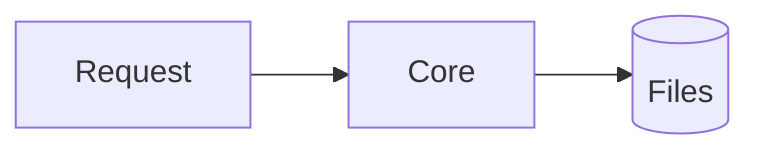

Docs, epics and tasks that are all prose are slow to scan. VibeDoc draws two kinds of visuals, and both stay plain text in the file, so GitHub, a diff and any agent read them as they are.

## Diagrams

A ` ```mermaid ` fence renders in VibeDoc's own style (hairlines, one accent, light and dark). Mark the node that matters with `class X accent`:

````markdown

````

Hover a diagram for **Fullscreen** (zoom with the wheel or `+` `−`, drag to pan, `0` to fit), **Copy image** and **Copy source**. A diagram that doesn't parse shows the error and its source in place.

## Visual blocks

A comment marker on the line above a plain list. VibeDoc draws the list; everywhere else it is just the list, because the marker is an HTML comment.

| Marker | Draws |
|---|---|
| `<!-- vibedoc:steps -->` | cards stacked top to bottom, joined by arrows |
| `<!-- vibedoc:cards -->` | a grid of cards |
| `<!-- vibedoc:compare -->` | 2–3 columns side by side; each item's nested bullets are its points |
| `<!-- vibedoc:timeline -->` | a rail with a dot per item; the item titled "Now" gets the accent |

```markdown
<!-- vibedoc:steps -->
1. **🎯 Focus** — one main goal at a time.
   Example: finish the transaction flow.
2. **Queue** — new asks wait in a queue.
3. **State** — write down where you are before you stop.
```

Each item: the leading **bold** is the title (an emoji at its start becomes the icon), the rest of the line the description, the indented lines below it muted detail.

**Copy** on a block puts both versions on the clipboard: paste into Google Docs, Notion, Slack or an email and it keeps its cards; paste into an editor or an agent and you get the markdown.

The editor toolbar's **Insert diagram or visual block** menu starts any of them for you.

## Diagrams VibeDoc draws for you

Some pictures come from the project itself and are never written down: a task's dependencies (in its panel and its doc), an epic's tasks with the scenarios each covers (on the epic sheet), and a doc's links in and out (in the Linked docs panel). Agents get the same structure as text: [`vibedoc_get_task`](/vibedoc/docs/tools/vibedoc_get_task/) ends with `## Dependencies`, and [`vibedoc_get_roadmap`](/vibedoc/docs/tools/vibedoc_get_roadmap/) with an `id` lists an epic's tasks in dependency order with their scenarios.

## For agents

The `/vibedoc:roadmap`, `/vibedoc:breakdown` and `/vibedoc:work` skills add a fitting visual when an epic, task or doc has a shape, picking the type by the question the reader asks and keeping it small. Type guidance adapted from [diagram-design](https://github.com/cathrynlavery/diagram-design).
